<!-- README.en.md -->

  

<h1 align="center">Gabriel Travensolli</h1>
<h3 align="center">Backend & Applied AI Developer · Python · TypeScript · Automation</h3>

  <a href="https://github.com/travensolli">🇧🇷 Português</a> · 🇺🇸 English

  
  
  
  

---

## 👨‍💻 About me

I build backend services, automations and generative AI applications. At my current job, at a company specialized in legal calculations for court cases, I develop microservices, AI document pipelines and RPA automations that take repetitive work off people's plates. Outside work, I build **AI agent workflows** (Claude Code, OpenAI, Gemini) to solve real problems in content production, teaching and data analysis. I hold a degree in Control and Automation Engineering, I'm studying Multiplatform Software Development at Fatec Jacareí (Brazil), and I've also worked briefly as a computer science teacher.

**🔭 Currently**
- Top contributor to **[EcoPulse](https://github.com/DEVassos/ecopulse-app)**, a GreenOps platform built as Fatec's 2nd-semester team project
- Building **[livro-de-receitas](https://github.com/travensolli/livro-de-receitas)**, a full-stack TypeScript app with CI/CD and production deployment
- In the 2nd semester of the Multiplatform Software Development program at Fatec Jacareí

**🧪 Recent projects** (private repositories)
- **Agent-driven video pipeline:** adapted an open-source Claude Code workflow for narrated *faceless* videos, from script to final cut (TTS, HTML/GSAP animations, sound effects and FFmpeg compositing)
- **AI editorial pipelines:** print-ready English workbooks written in HTML/CSS (volume 1: 438 pages, 500 exercises) and educational ebooks, with agents for writing, review and layout
- **Computer vision:** vehicle counting at a supermarket parking entrance using a Wi-Fi camera, producing hourly flow, peak hours and estimated occupancy
- **Teaching support:** a Claude Code–driven environment to plan lessons, generate slides and track computer science classes

---

## 💼 Professional experience

**Developer · legal calculations company** (current)

- **AI pipeline for legal documents:** **FastAPI** microservices that extract text from PDFs (OCR with **Azure Document Intelligence**), classify each document using **embeddings**, crop the relevant sections, and are coordinated by an orchestrator service, with a **React** frontend.
- **Asynchronous processing:** a transactional HTTP service that stores requests in **PostgreSQL** and publishes events to **RabbitMQ**, consumed by a worker that drives a legacy system through **Playwright**.
- **RPA & integrations:** bots that download case files from court systems and upload them to SharePoint/OneDrive via the **Microsoft Graph API**, a captcha-solving API, and data tools for calculation spreadsheets.
- **Engineering:** CI/CD pipelines with **GitHub Actions** integrated with **Jenkins**, REST APIs and **Scrum** routines (sprints, refinements, dailies and retrospectives).

---

## 🚀 Featured projects

| Project | What it is | Stack |
|---------|------------|-------|
| 🌱 **[EcoPulse](https://github.com/DEVassos/ecopulse-app)** | GreenOps platform that turns infrastructure metrics into energy use (kWh) and carbon footprint (gCO₂e). Team project where I'm the **top contributor: 432 commits and 82 PRs** | TypeScript · React · Node.js · PostgreSQL · Docker |
| 🍲 **[livro-de-receitas](https://github.com/travensolli/livro-de-receitas)** | Public recipe collection with menus and curation. Monorepo with CI (lint, types, tests, migrations) and automated deployment via GHCR and Docker Compose | TypeScript · Fastify · Drizzle · PostgreSQL · React |
| 🃏 **[vocabulary-flashcard-generator](https://github.com/travensolli/vocabulary-flashcard-generator)** · [🌐 Demo](https://vocabulary-flashcard-generator.vercel.app/) | Generates children's vocabulary flashcards with illustrations in multiple styles using generative AI | TypeScript · React · Express · Gemini API |
| 📷 **[cr2-jpeg-converter](https://github.com/travensolli/cr2-jpeg-converter)** | Desktop app that converts Canon RAW photos to JPEG, in batch and fully offline, with preview and camera metadata | Python · PySide6 · rawpy · pytest |
| 🎯 **[roda-da-vida-app](https://github.com/travensolli/roda-da-vida-app)** · [🌐 Demo](https://roda-da-vida-app.vercel.app) | Interactive personal-balance assessment across 7 life pillars, with a radar chart | Next.js · TypeScript · Tailwind · Recharts |
| 💬 **[assistente-financeiro-whatsapp](https://github.com/travensolli/assistente-financeiro-whatsapp)** | Logs expenses and income sent in natural language over WhatsApp and saves them to Google Sheets | Python · FastAPI · Twilio · OpenAI API |
| 📰 **[feed-analyzer](https://github.com/travensolli/feed-analyzer)** | Collects RSS news, summarizes it with AI and ranks it by relevance | Python · SQLite · OpenAI API |

Other projects

 

| Project | What it is | Stack |
|---------|------------|-------|
| [serietrack-mc](https://github.com/travensolli/serietrack-mc) | Starter code for the capstone project I prepared as a computer science teacher: a TV series catalog using the TMDB API, planned in 3 sprints for the class | React · FastAPI · SQLite |
| [gera-apostas-lotofacil](https://github.com/travensolli/gera-apostas-lotofacil) | Statistical analysis of historical lottery results and bet generation with OpenAI | Python · OpenAI API |
| [datascience](https://github.com/travensolli/datascience) | Data science and mathematical modeling projects | Python |
| [python_scripts](https://github.com/travensolli/python_scripts) | Scripts and notebooks for automation and data processing | Python · Jupyter |
| [formacao_dados_DNC](https://github.com/travensolli/formacao_dados_DNC) | Exercises from the DNC Data Training course | Python · Jupyter |

---

## 🎓 Fatec · Multiplatform Software Development

| Project | What it is | Stack |
|---------|------------|-------|
| [scrum-flow-abp](https://github.com/DEVassos/scrum-flow-abp) | Internal agile-methodology certification portal (1st-semester team project). I was the **Scrum Master** of a 7-person team using Git Flow | JavaScript · Node.js · PostgreSQL |
| [estrutura-dados-recursao](https://github.com/travensolli/estrutura-dados-recursao) | Recursive factorial, Fibonacci and Tribonacci with and without memoization: benchmarks on `worker_threads`, call trees and a written report | TypeScript · Fastify · React · Vitest |
| [isw029-atividade3](https://github.com/travensolli/isw029-atividade3) | API refactored for dependency injection (repositories and services behind interfaces), running on Docker Compose | TypeScript · Express · PostgreSQL · Docker |

📚 Coursework

 

| Course | Repositories |
|--------|--------------|
| Web Development (Express + PostgreSQL) | [activity 1](https://github.com/travensolli/isw028-atividade1) · [activity 2](https://github.com/travensolli/isw028-atividade2) · [activity 3](https://github.com/travensolli/isw028-atividade3) · [activity 4](https://github.com/travensolli/isw028-atividade4) · [activity 5](https://github.com/travensolli/isw028-atividade5) · [CSS layout](https://github.com/travensolli/isw028-layout-css) |
| Algorithms & Logic (JS/TS) | [1](https://github.com/travensolli/ial010-atividade1) · [2](https://github.com/travensolli/ial010-atividade2) · [3](https://github.com/travensolli/ial010-atividade3) · [4](https://github.com/travensolli/ial010-atividade4) · [5](https://github.com/travensolli/ial010-atividade5) · [6](https://github.com/travensolli/ial010-atividade6) · [7](https://github.com/travensolli/ial010-atividade7) · [8](https://github.com/travensolli/ial010-atividade8) |
| Databases | [Instagram sales data modeling](https://github.com/travensolli/ibd014-modelagem-vendas-instagram) |
| Software Engineering | [UML for an academic system](https://github.com/travensolli/ies011-uml-sistema-academico) |
| Digital Design | [BirdSpot Figma prototype](https://github.com/travensolli/isw031-birdspot) |

All coursework: **[Fatec portfolio](https://fatec-jacarei-dsm-portfolio.github.io/ra2581392613017/)**

---

## 🛠️ Tech stack

**Languages** 

**Backend & messaging** 

**Frontend** 

**AI** 

**Automation, testing & DevOps** 

**Data** 

---

## 📊 GitHub

<!-- Cards generated daily by .github/workflows/metrics.yml on the output branch -->

  <picture>
    <source media="(prefers-color-scheme: dark)" srcset="https://raw.githubusercontent.com/travensolli/travensolli/output/profile/stats-dark.svg"/>
    
  </picture>
  <picture>
    <source media="(prefers-color-scheme: dark)" srcset="https://raw.githubusercontent.com/travensolli/travensolli/output/profile/top-langs-dark.svg"/>
    
  </picture>

  <picture>
    <source media="(prefers-color-scheme: dark)" srcset="https://streak-stats.demolab.com/?user=travensolli&hide_border=true&theme=github-dark-blue"/>
    
  </picture>

---

## 🎓 Education

- 🏫 **Associate degree in Multiplatform Software Development** · Fatec Jacareí · in progress
- 🎓 **Bachelor's degree in Control and Automation Engineering** · UNIFEI, Itabira campus · 2017

---

<em>Open to new opportunities. Feel free to explore my projects or reach out on <a href="https://www.linkedin.com/in/gabrieltravensolli/">LinkedIn</a>.</em>

