<!-- README.md -->

  

<h1 align="center">Gabriel Travensolli</h1>
<h3 align="center">Desenvolvedor Backend & IA aplicada · Python · TypeScript · Automação</h3>

  🇧🇷 Português · <a href="README.en.md">🇺🇸 English</a>

  
  
  
  

---

## 👨‍💻 Sobre mim

Desenvolvo serviços backend, automações e aplicações com IA generativa. Na empresa onde trabalho, especializada em cálculos de processos judiciais, construo microsserviços, pipelines de documentos com IA e automações (RPA) que tiram trabalho repetitivo das equipes. Fora dela, monto **fluxos de trabalho com agentes de IA** (Claude Code, OpenAI, Gemini) para resolver problemas reais de produção de conteúdo, ensino e análise de dados. Sou engenheiro de Controle e Automação de formação, curso Desenvolvimento de Software Multiplataforma na Fatec Jacareí e tive uma passagem como professor de informática.

**🔭 Atualmente**
- Principal contribuidor do **[EcoPulse](https://github.com/DEVassos/ecopulse-app)**, plataforma GreenOps da ABP do 2º semestre na Fatec
- Construindo o **[livro-de-receitas](https://github.com/travensolli/livro-de-receitas)**, fullstack TypeScript com CI/CD e deploy em produção
- Cursando o 2º semestre de DSM na Fatec Jacareí

**🧪 Projetos recentes** (repositórios privados)
- **Pipeline de vídeo com agentes:** adaptei um fluxo open source do Claude Code para vídeos *faceless* narrados, do roteiro ao vídeo final (TTS, animações em HTML/GSAP, efeitos sonoros e composição com FFmpeg)
- **Esteiras editoriais com IA:** produção de workbooks de inglês em HTML/CSS para impressão (volume 1 com 438 páginas e 500 exercícios) e de ebooks educacionais, com agentes para redação, revisão e diagramação
- **Visão computacional:** contagem de veículos na entrada do estacionamento de um supermercado com câmera Wi-Fi, gerando fluxo por hora, horários de pico e ocupação estimada
- **Apoio à docência:** ambiente operado pelo Claude Code para planejar aulas, gerar slides e acompanhar turmas de informática

---

## 💼 Experiência profissional

**Desenvolvedor · empresa de cálculos judiciais** (atual)

- **Pipeline de IA para documentos jurídicos:** microsserviços **FastAPI** que extraem texto de PDFs (OCR com **Azure Document Intelligence**), identificam o tipo de cada documento por **embeddings**, recortam as peças relevantes e são coordenados por um orquestrador, com frontend em **React**.
- **Processamento assíncrono:** serviço HTTP transacional que grava as solicitações no **PostgreSQL** e publica eventos no **RabbitMQ**, consumidos por um worker que opera um sistema legado via **Playwright**.
- **RPA e integrações:** robôs que baixam processos de sistemas judiciais e enviam os arquivos ao SharePoint/OneDrive pela **Microsoft Graph API**, uma API de resolução de captchas e ferramentas de dados para as planilhas de cálculo.
- **Engenharia:** pipelines de CI/CD com **GitHub Actions** integrado ao **Jenkins**, APIs REST e rotina **Scrum** (sprints, refinamentos, dailies e retrospectivas).

---

## 🚀 Projetos em destaque

| Projeto | O que é | Stack |
|---------|---------|-------|
| 🌱 **[EcoPulse](https://github.com/DEVassos/ecopulse-app)** | Plataforma GreenOps que converte métricas de infraestrutura em consumo de energia (kWh) e pegada de carbono (gCO₂e). Projeto em equipe, em que sou **principal contribuidor: 432 commits e 82 PRs** | TypeScript · React · Node.js · PostgreSQL · Docker |
| 🍲 **[livro-de-receitas](https://github.com/travensolli/livro-de-receitas)** | Acervo público de receitas com cardápios e curadoria. Monorepo com CI (lint, tipos, testes, migrações) e deploy automatizado com GHCR e Docker Compose | TypeScript · Fastify · Drizzle · PostgreSQL · React |
| 🃏 **[vocabulary-flashcard-generator](https://github.com/travensolli/vocabulary-flashcard-generator)** · [🌐 Demo](https://vocabulary-flashcard-generator.vercel.app/) | Gera flashcards de vocabulário infantil com ilustrações em vários estilos via IA generativa | TypeScript · React · Express · Gemini API |
| 📷 **[cr2-jpeg-converter](https://github.com/travensolli/cr2-jpeg-converter)** | App desktop que converte fotos Canon RAW em JPEG, em lote e 100% offline, com pré-visualização e metadados da câmera | Python · PySide6 · rawpy · pytest |
| 🎯 **[roda-da-vida-app](https://github.com/travensolli/roda-da-vida-app)** · [🌐 Demo](https://roda-da-vida-app.vercel.app) | Avaliação interativa de equilíbrio pessoal em 7 pilares, com gráfico radar | Next.js · TypeScript · Tailwind · Recharts |
| 💬 **[assistente-financeiro-whatsapp](https://github.com/travensolli/assistente-financeiro-whatsapp)** | Registra gastos e ganhos enviados em linguagem natural pelo WhatsApp e salva no Google Sheets | Python · FastAPI · Twilio · OpenAI API |
| 📰 **[feed-analyzer](https://github.com/travensolli/feed-analyzer)** | Coleta notícias RSS, resume com IA e prioriza por relevância | Python · SQLite · OpenAI API |

Outros projetos

 

| Projeto | O que é | Stack |
|---------|---------|-------|
| [serietrack-mc](https://github.com/travensolli/serietrack-mc) | Esqueleto do projeto integrador que preparei como professor de informática: catálogo de séries com a API do TMDB, planejado em 3 sprints para a turma | React · FastAPI · SQLite |
| [gera-apostas-lotofacil](https://github.com/travensolli/gera-apostas-lotofacil) | Análise estatística de resultados históricos e geração de apostas com OpenAI | Python · OpenAI API |
| [datascience](https://github.com/travensolli/datascience) | Projetos de ciência de dados e modelagem matemática | Python |
| [python_scripts](https://github.com/travensolli/python_scripts) | Scripts e notebooks de automação e processamento de dados | Python · Jupyter |
| [formacao_dados_DNC](https://github.com/travensolli/formacao_dados_DNC) | Exercícios do curso Formação em Dados (DNC) | Python · Jupyter |

---

## 🎓 Fatec · Desenvolvimento de Software Multiplataforma

| Projeto | O que é | Stack |
|---------|---------|-------|
| [scrum-flow-abp](https://github.com/DEVassos/scrum-flow-abp) | Portal de certificação interna em metodologia ágil (ABP do 1º semestre). Atuei como **Scrum Master** de uma equipe de 7 pessoas com Git Flow | JavaScript · Node.js · PostgreSQL |
| [estrutura-dados-recursao](https://github.com/travensolli/estrutura-dados-recursao) | Fatorial, Fibonacci e Tribonacci recursivos com e sem memoização: benchmark em `worker_threads`, árvore de chamadas e artigo | TypeScript · Fastify · React · Vitest |
| [isw029-atividade3](https://github.com/travensolli/isw029-atividade3) | API refatorada para injeção de dependência (repositórios e serviços por interface), rodando com Docker Compose | TypeScript · Express · PostgreSQL · Docker |

📚 Exercícios das disciplinas

 

| Disciplina | Repositórios |
|------------|--------------|
| Desenvolvimento Web (Express + PostgreSQL) | [atividade1](https://github.com/travensolli/isw028-atividade1) · [atividade2](https://github.com/travensolli/isw028-atividade2) · [atividade3](https://github.com/travensolli/isw028-atividade3) · [atividade4](https://github.com/travensolli/isw028-atividade4) · [atividade5](https://github.com/travensolli/isw028-atividade5) · [layout CSS](https://github.com/travensolli/isw028-layout-css) |
| Algoritmos e Lógica (JS/TS) | [1](https://github.com/travensolli/ial010-atividade1) · [2](https://github.com/travensolli/ial010-atividade2) · [3](https://github.com/travensolli/ial010-atividade3) · [4](https://github.com/travensolli/ial010-atividade4) · [5](https://github.com/travensolli/ial010-atividade5) · [6](https://github.com/travensolli/ial010-atividade6) · [7](https://github.com/travensolli/ial010-atividade7) · [8](https://github.com/travensolli/ial010-atividade8) |
| Banco de Dados | [modelagem de vendas pelo Instagram](https://github.com/travensolli/ibd014-modelagem-vendas-instagram) |
| Engenharia de Software | [UML de sistema acadêmico](https://github.com/travensolli/ies011-uml-sistema-academico) |
| Design Digital | [protótipo BirdSpot no Figma](https://github.com/travensolli/isw031-birdspot) |

Todos os trabalhos do curso: **[portfólio Fatec](https://fatec-jacarei-dsm-portfolio.github.io/ra2581392613017/)**

---

## 🛠️ Stack

**Linguagens** 

**Backend & mensageria** 

**Frontend** 

**IA** 

**Automação, testes & DevOps** 

**Dados** 

---

## 📊 GitHub

<!-- Cards gerados diariamente pelo workflow .github/workflows/metrics.yml na branch output -->

  <picture>
    <source media="(prefers-color-scheme: dark)" srcset="https://raw.githubusercontent.com/travensolli/travensolli/output/profile/stats-dark.svg"/>
    
  </picture>
  <picture>
    <source media="(prefers-color-scheme: dark)" srcset="https://raw.githubusercontent.com/travensolli/travensolli/output/profile/top-langs-dark.svg"/>
    
  </picture>

  <picture>
    <source media="(prefers-color-scheme: dark)" srcset="https://streak-stats.demolab.com/?user=travensolli&hide_border=true&theme=github-dark-blue"/>
    
  </picture>

---

## 🎓 Formação

- 🏫 **Tecnólogo em Desenvolvimento de Software Multiplataforma** · Fatec Jacareí · em andamento
- 🎓 **Bacharelado em Engenharia de Controle e Automação** · UNIFEI, campus Itabira · 2017

---

<em>Aberto a novas oportunidades. Fique à vontade para explorar os projetos ou me chamar no <a href="https://www.linkedin.com/in/gabrieltravensolli/">LinkedIn</a>.</em>

